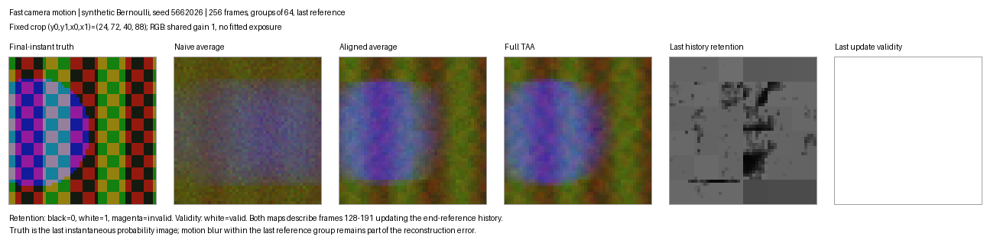
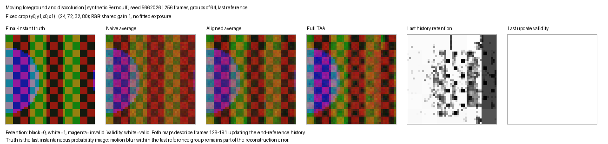

# TAA failure gallery: fast motion and disocclusion

Issue #26. These two controlled synthetic examples show failures of naive
averaging, block-aligned averaging and TAA, including negative TAA results.
Both were run on November 11, 2026 with the unchanged production aligner.
They are Bernoulli simulations with known photon-detection probabilities,
not Single Photon Challenge scenes, visionsim runs or held-out evaluation.

## Reproduction and common protocol

From the repository root:

```bash
venv/bin/python scripts/make_taa_failure_gallery.py
venv/bin/python -m unittest tests.test_taa_failure_gallery -v
```

The generator uses seed `5662026`, 256 binary RGB frames of size 96 by 128,
and 64-frame groups. The fixed reference for aligned averaging and TAA is
the mean of frames 192 through 255. All methods receive identical input
arrays and are scored on the same predeclared crop. Each RGB reconstruction
uses the identity intensity rule, because the synthetic target is already a
known photon probability. This rule is distinct from the provisional gain
2.7 used for SPC RGB ground truth; these scores must not enter that table.

The target is the probability image at frame 255, not the time average of
the last reference group. Thus motion blur inside the reference exposure
counts as reconstruction error. PSNR and SSIM use the existing
`evaluate_channels` implementation: arithmetic RGB-channel means and a
7 by 7 uniform, reflect-padded SSIM window. Every pixel in each crop is
scored, without a method-dependent validity mask. Crops were fixed from
the scene geometry before reconstructing or inspecting scores. The figures
use the same fixed display scale with no autocontrast or fitted exposure.

TAA starts with the last-group reference once and then consumes the other
groups in chronological order: frames 0–63, 64–127 and 128–191. Therefore,
the displayed retention and validity maps describe the update from frames
128–191. They are not final-frame visibility estimates. Retention is the
fraction of previous history weight retained; it is neither the final blend
coefficient nor the aligner's separate block-confidence diagnostic.
Black and white denote retention 0 and 1. Magenta denotes an invalid
observation, which preserves history instead of rejecting it. The separate
validity panel makes this distinction explicit. All crop pixels happen to
be valid in the last update of these two runs.

The [machine-readable metrics](assets/taa-failures/metrics.csv) and
[manifest](assets/taa-failures/manifest.json) record the seed sequence, crop,
motion at every frame, input-array hashes, source hashes, versions and figure
hashes. Reconstruction arrays and diagnostics are written to the ignored
directory `results/sample_taa/failure_gallery/`; no synthetic burst arrays
are committed. Disabling TAA matched the aligned baseline exactly in both
runs, with identical accumulation weights and geometrical coverage.

## Fast camera motion



The camera advances 48 pixels across 255 frame intervals over a textured
scene. Sampling a wider scene avoids wrapped image boundaries. The fixed
crop is `(24,72,40,88)` in `(y0,y1,x0,x1)` coordinates. Motion is applied
at every binary exposure, rather than only between group means.

Naive averaging smears the fine checkerboard and vertical edges. Alignment
recovers more of the broad color structure, but cannot restore fine detail
already averaged away inside a 64-frame group. TAA also loses that detail
and scores below the aligned baseline. The clean last-group exposure mean
itself has MSE `0.047486` against the instantaneous target in this crop,
demonstrating that even an error-free estimate of that group mean would
remain blurred. This is a diagnostic of exposure blur, not a lower bound
on all possible burst reconstruction methods.

Mean last-update history retention is `0.356981` in the crop. Low retention
does not undo within-group blur or establish that the incoming observation
is sharper or more accurate.

| Method | Mean-channel PSNR (dB) | Mean-channel SSIM |
|---|---:|---:|
| Naive | 12.2292 | 0.133619 |
| Aligned | 14.0815 | 0.184635 |
| TAA | 13.7149 | 0.174928 |

## Moving foreground and disocclusion



A 32-pixel-wide opaque foreground slab moves from x=24 to x=96 over a
stationary patterned background. It occupies rows 12 through 83. The fixed
crop `(24,72,32,80)` shows background revealed by the end of the burst.
The slab's RGB photon probabilities are `(0.68,0.16,0.13)`.

Naive averaging leaves foreground color mixed into the revealed background.
Block alignment reduces some contamination but has no visibility model;
foreground and background do not share one translation. Full TAA retains
more fine contrast in some locations while introducing uneven color and
texture errors. Its PSNR and SSIM are both below the aligned baseline.
Clamping history toward an incoming, still-occluded group can discard
valid background from the end-reference initialization. The incoming group
is not guaranteed to depict the target surface, and neighborhood bounds
cannot identify that surface by themselves.

The mean last-update retention is `0.736648` despite visible reconstruction
errors. A high value means the heuristic accepted much of the prior weight;
it is not evidence of correct disocclusion handling.

| Method | Mean-channel PSNR (dB) | Mean-channel SSIM |
|---|---:|---:|
| Naive | 20.1798 | 0.774650 |
| Aligned | 21.7157 | 0.805808 |
| TAA | 20.7482 | 0.731874 |

## Limits

These are two designed examples with one seeded noise realization each.
They isolate plausible failure mechanisms and provide reproducible crops,
not a motion-speed sweep or an estimate of average dataset performance.
The texture is deliberately simple and repetitive, which can also make
block matches ambiguous. No parameters were selected using these scores.
Real SPC disocclusion labels and the planned visionsim sweep are not
established by this gallery. The main kitchen1 comparison and component
ablations must retain their own shared data, reference and intensity rule.
